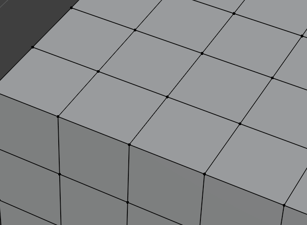
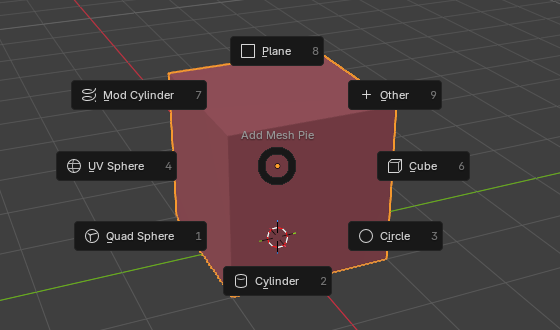
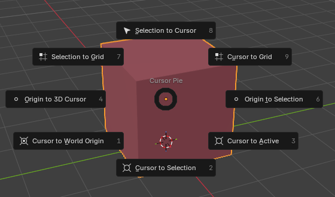
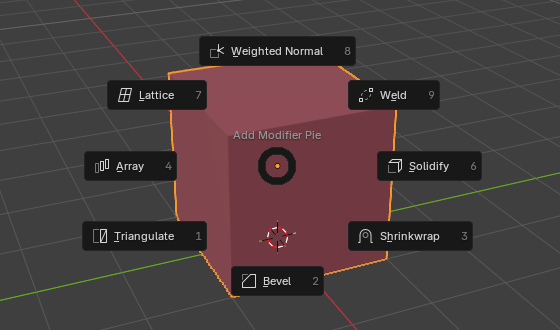
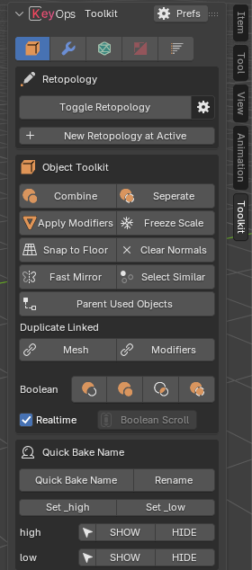
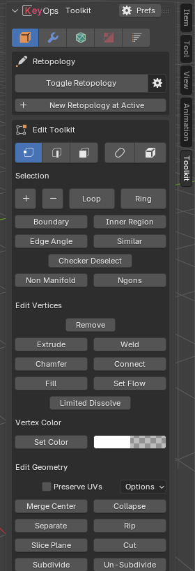
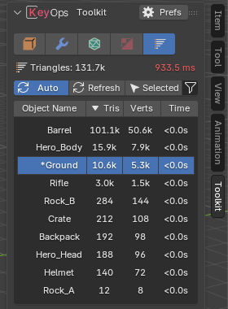

  

<h1 align="center">Key Ops: Toolkit</h1>

  Industry standard tools and shortcuts for Blender. 
  Maya-style navigation and selection, fast interactive modeling tools, pie menus and a game-art toolkit. 
  <b>Every feature can be turned on or off.</b>

  <a href="https://extensions.blender.org/add-ons/key-ops-toolkit/"><b>Get it on Blender Extensions</b></a> ·
  <a href="https://dangry98.github.io/Key-Ops-Toolkit/"><b>Documentation</b></a> ·
  <a href="https://dangry98.github.io/Key-Ops-Toolkit/shortcuts.html"><b>Shortcut cheat sheet</b></a>

  
  
  

---

## Features

### Industry Standard
Navigation and selection that work like Maya.

| Feature | Key | |
|---|---|---|
| Alt Navigation | `Alt` + mouse | Orbit, pan and zoom like Maya. Works in the 3D Viewport, UV, Image and 2D editors. Optional tablet mode. |
| Double Click Select Island | Double-click | Select an island or edge loop. `Shift` adds, `Ctrl` deselects. Works on meshes, UVs and curves. |
| Auto Delete | `Delete` | Delete without the menu, with optional dissolve in edge mode. |
| Maya Pivot | `D` | Move and rotate the pivot in place. Hold or toggle. |
| Toggle Retopology | `5` | One key for a full retopology setup (tool, theme, snapping). Press again to go back. |

### Modeling Tools
Fast, interactive tools. While a tool runs, its keys are listed in the status bar.

- **Merge Tool** – drag a vertex or edge onto another to merge them.
- **Fast Loop Cut** (`Alt R`) – hover to preview, click to cut. No slide step. Even, center and edge-flow modes.
- **Cutter** – draw a box, circle or ngon to boolean-cut (difference, union, intersect, slice) or add new geometry. The boolean is only added on release, so drawing stays fast on heavy meshes.
- **Fast Mirror** (`Alt X`) – click a block to mirror on that axis; hold a modifier key to bisect, symmetrize or flip instead.
- **Fast Bevel / Array / Solidify** – drag and scroll to set up modifiers interactively from the Add Modifier pie.
- **Booleans** (`Ctrl Numpad - + * /`) – difference, union, intersect and slice on the selection.
- **Snap to Floor** (`Alt 3`), **Select Similar**, **X-Ray Select**.

### Pie Menus

  
  
  

| Pie | Key |
|---|---|
| Add Objects – primitives sized to your view | `Shift Alt A` |
| Add Modifier | `Shift Q` *(off by default)* |
| Cursor – snapping plus set origin | `Shift S` |
| Flatten – flatten the selection from the view | `Alt 3` (Edit Mode) |
| Workspace | `Shift \` *(off by default)* |
| View Camera | `Space` (via Rebind tab) |
| Utility / UV Pies | `U` / `Space` · `Q` *(experimental)* |

### Toolkit Panel
Everything lives in the **Toolkit** tab of the 3D Viewport sidebar (`N`).

  
  
  

- **Object Toolkit** – combine/separate keeping normals and UVs, fast apply modifiers (`Alt C`), freeze scale, parent used objects, duplicate linked modifiers.
- **Edit Toolkit** – subdivide / un-subdivide cylinder, set flow, offset extrude edge, LoopTools integration.
- **CAD Decimate** – decimate huge scenes without crashing (tested on 330 million triangles).
- **Auto LOD** – generate LODs in one click with normal transfer and weighted normals.
- **Polycount List** – live triangle count per object.
- **Quick Bake Name** – name `_high` / `_low` pairs for baking.
- **Quick Export** (`Ctrl E`) – export the selection in one key, straight into a Bake folder.
- **Material Utils** (`Alt M`) – quick material list.

### UV
- **Smart UV Sync** (`RMB`) – right-click toggles UV Sync while keeping the selection.
- **UV Cut** (`X` / `Shift X`) – Maya-style cut and move island, or just cut.
- **Remove Seam** (`Alt 2`) – clear seams and sharp edges.
- Unwrap in place, quick pack and more in the UV Pies.

### Extras
- **Fast Merge & Connect** (`1` · `Alt 1` · `Shift 1`) – merge to nearest/active, merge at center, connect/join/knife.
- **Modifier Key** – keyboard control of the modifier stack in the Properties Editor.
- **Attribute Operations**, **Viewport Menu** (`Alt V`), **Outliner Options**, **LoopTools Menu**.
- **Legacy Shortcuts** – handy shortcuts from Blender 2.79 (poke, grow/shrink, UV copy/paste…).

### Rebind
One-click changes to Blender's own keymap: context menu on right-click, Add Objects Pie on `Shift A`, View pie on `Space`, and no-lag pie menus. Each has a reset button.

## Documentation

Full docs, with screenshots and every shortcut, are at **[dangry98.github.io/Key-Ops-Toolkit](https://dangry98.github.io/Key-Ops-Toolkit/)**.

- [Industry Standard](https://dangry98.github.io/Key-Ops-Toolkit/industry-standard.html)
- [Modeling Tools](https://dangry98.github.io/Key-Ops-Toolkit/modeling-tools.html)
- [Pie Menus](https://dangry98.github.io/Key-Ops-Toolkit/pie-menus.html)
- [Toolkit Panel](https://dangry98.github.io/Key-Ops-Toolkit/toolkit.html)
- [UV](https://dangry98.github.io/Key-Ops-Toolkit/uv.html)
- [Extras](https://dangry98.github.io/Key-Ops-Toolkit/extras.html)
- [Preferences](https://dangry98.github.io/Key-Ops-Toolkit/preferences.html)
- [Shortcut Cheat Sheet](https://dangry98.github.io/Key-Ops-Toolkit/shortcuts.html)

## Credits & License

Key Ops: Toolkit by [Dan-Gry](https://github.com/Dangry98), with code based on [MACHIN3tools](https://machin3.io/MACHIN3tools/).

Licensed under the [GNU General Public License v3.0 or later](https://www.gnu.org/licenses/gpl-3.0.html).
